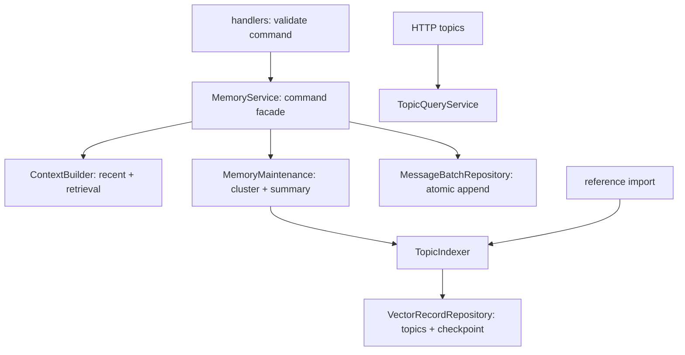

# ADR 0001: согласованные границы модулей

Статус: принято.

Приложение остаётся модульным монолитом. Для расширения не нужны микросервисы,
универсальный framework use-case-классов или отдельная доменная обёртка для каждого
CRUD-поля. Выделяем слой, когда у него есть собственная ответственность.

## Направление зависимостей

* `domain/` — общие сущности чата и минимальные Protocol-контракты AI.
  Не импортирует модули, ORM, FastAPI или SDK провайдеров.
* `base/`, `bus/`, `core/`, `utils/` — общая инфраструктура.
* `modules/<name>/` — владелец своих моделей, правил, репозиториев, схем и API.
  Сервис не импортирует реализацию соседнего модуля.
* `composition/` и `main.py` — сборка приложения. Здесь разрешено связывать
  реализацию одного модуля с портом другого. `composition/ai.py` содержит
  локальные адаптеры фабрик для memory и behavior; тест может передать fake напрямую.

События остаются публичными контрактами владельца в `schemas/events.py`, имена
топиков — в `BusTopics`. Структурированные `ChatRef`, `Batch`, `Message`, `Topic`,
`ConversationContext` используются от канала до LLM. Контекст не превращается в
строку в orchestrator или memory: промпт собирает модуль LLM.

Устаревшие импорты `core.container`, `core.seed`, `memory.service`,
`llm.providers.base`, `behavior.report` оставлены совместимыми. Новые вызовы
используют владельца реализации, а не эти переходные экспорты.
Регистрация ORM-моделей в `core.database` — явное исключение для SQLAlchemy metadata.

## Структура модуля

* `models.py` — ORM, `repository.py` — SQL и границы записи в БД.
* `service.py` для компактного модуля или `services/` для нескольких задач.
* `dependencies.py` — создание репозиториев и сервисов; долгоживущие компоненты
  создаются один раз при регистрации обработчиков, а не на каждое событие.
* `handlers.py` — валидация команды и управление временем жизни сессии.
* `schemas/public.py` — HTTP DTO; `schemas/events.py` — команды и события.
* `routers/` — HTTP, авторизация, преобразование результата в DTO.
* `config.py` — настройки модуля с общим `EnvironmentSettings`.

Не добавляем пустые репозитории или HTTP-роутеры к in-memory/bus-only модулям.
Не переносим специфичные для одного модуля правила в `domain/` ради одинакового
количества файлов. Общий код выносится при наличии общего смысла, а не похожих имён.

Репозиторий инкапсулирует SQL. Существующий CRUD фиксирует отдельную операцию;
составные записи памяти используют явные атомарные методы. События об успешной
записи публикуются после успешного commit. Шина должна быть явно настроена:
неявное создание изолированной шины через `get_producer()` запрещено.

## Память

* `services/pipeline.py` сохраняет сообщения и публикует события. Входящие и
  исходящие сообщения используют один `append_messages`: пакет, номера сообщений
  и сообщения фиксируются вместе. Ошибка не оставляет половину пакета.
* `services/context.py` собирает контекст; не публикует его в шину самостоятельно.
  Отказ AI-поиска сохраняет доступность recent/summary, как в прежнем поведении.
* `services/maintenance.py` обслуживает историю последовательно для одного диалога.
  Summary включает только сообщения до своего checkpoint. Неактивные lock-объекты
  не удерживаются бессрочно.
* `services/indexing.py` содержит общий retry/validation и запись тем для живого
  диалога и reference-import. Все embeddings проверяются по количеству до записи;
  темы и cluster checkpoint сохраняются одной транзакцией.
* `services/topics.py` читает темы для панели без зависимости от AI и его ключей.
* `services/crud.py` содержит обычные административные CRUD-сервисы.

Для нового способа поиска меняется ContextBuilder, для нового алгоритма
индексации — TopicIndexer, для нового источника эталонов — импортёр. Маршрутизацию
событий и хранение истории при этом переписывать не требуется.

## Проверки и границы гарантий

`tests/test_architecture.py` проверяет существование импортируемых исходников,
изоляцию реализаций модулей и отсутствие SQL в use cases памяти. Регрессионные
тесты проверяют откат пакета/индекса, sequence numbers, checkpoint и полный
in-memory pipeline, включая доставку сообщений.

Текущие lock/state/batching живут в процессе. Для нескольких worker нужны
распределённая сериализация по ключу чата и durable state. Публикация после commit
ещё не даёт exactly-once: для надёжной доставки между БД и Kafka понадобится outbox
и идемпотентность потребителей. Это отдельные изменения поведения, не скрытая
гарантия данного рефакторинга. Схема БД и публичные HTTP-маршруты не менялись.
