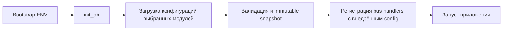

# ADR 0004: конфигурация модулей с переопределениями в БД

Статус: принят; backend и интерфейс администратора реализованы для всех 11 модулей.

## Принятые решения

- Каждый модуль владеет пакетом `config/`, собственной таблицей и своим manager API.
- Общие классы находятся в `base/configuration`, не импортируют модули и не
  наследуются от обычного CRUD service/repository с внутренними commit.
- Типизированная схема наследует `BaseModuleConfig`, ORM-модель — абстрактный
  `BaseConfigModel`. Модульные repository/service задают привязку типов.
- В таблице одна строка `id=1`, ограниченная CHECK и PK. JSON содержит только
  переопределения; `revision` защищает от потерянных обновлений.
- Приоритет: БД → ENV/.env → дефолт. Сброс удаляет ключ переопределения.
- Все изменения применяются при следующем запуске процесса. Работающие компоненты
  получают неизменяемый снимок, установленный до регистрации обработчиков. API возвращает конфигурацию для следующего
  запуска и предупреждение, без публикации действующего снимка процесса.
- Схема проверяется целиком до записи. Изменение нескольких полей атомарно;
  запись с устаревшей revision возвращает 409, недопустимые поля/значения — 422.
- PATCH и reset используют SQL compare-and-swap. Commit/rollback принадлежат
  конфигурационному сервису, а не репозиторию.
- Параметры подключения/запуска и секреты остаются в ENV. В HTTP регистрируются
  только публичные конфигурационные схемы. Users пока не имеет изменяемых полей,
  но владеет своей таблицей и тем же API без выдуманных параметров.

## Порядок запуска

Сборка принадлежит `composition/application.py` и общему хосту из ADR 0005.
Все выбранные конфигурации валидируются до подготовки модулей и запуска шины.
`ConfigBinding` хранит неизменяемый типизированный снимок в течение жизни процесса;
API работает с сохранёнными значениями и не заменяет этот снимок. При остановке
привязки очищаются. Один процесс обслуживает один host; несколько одновременно
работающих приложений в одном Python-процессе не поддерживаются.

Недоступная таблица/БД или неверное известное значение блокирует startup с исходной
ошибкой; соединения закрываются. Нет молчаливого fallback. Отсутствующая строка
инициализируется без перезаписи существующей конфигурации.

В safe mode применяется тот же API и отдельная SQLite-база safe mode. Никаких
обращений к PostgreSQL, Kafka или внешним интеграциям для этого не требуется.

Неизвестные старые ключи сохраняются в JSON, исключаются из runtime и перечисляются
в `obsolete_keys`. Через reset их можно удалить. API не принимает новые неизвестные
ключи. Схема ENV должна быть валидна перед объединением с DB overrides.

## Область применения и ограничения

История всех ревизий и откат не реализованы: сохраняются последняя revision,
updated_at и updated_by. Решение о полном аудите остаётся для дальнейшего согласования.
Конфигурации аккаунтов/диалогов, live reload и автоматический restart worker не входят в этот этап. Перезапускать нужно все
процессы; optimistic locking обеспечивает согласованность записи в БД, не rollout.

Миграция не переписывает историческую baseline. Создание таблицы использует
checkfirst, потому что baseline создаёт актуальные metadata на чистой установке.

Конфигурационные endpoints находятся в обычном `module/routers/manager/configuration.py`.
Пакет `config/` не содержит роутеров. `main` подключает только `module.routers.router`;
сборка HTTP-маршрутов принадлежит самому модулю.

Префиксы собираются по уровням: `routers/__init__.py` → `manager/__init__.py`
(уровень доступа и пространство модуля) → `manager/configuration.py`
(только `/configuration`). В фабрику не передаётся полный API URL.

## Владельцы настроек

| Модуль / таблица | Управляемые параметры |
| --- | --- |
| auth / auth_configuration | Срок действия новых access tokens |
| users / users_configuration | Пока нет публичных параметров |
| llm / llm_configuration | Провайдер чата, модели, URL, sampling presets |
| telegram_clients / telegram_clients_configuration | Каталог сессий, метаданные клиента |
| instagram_clients / instagram_clients_configuration | Каталог сессий, интервал опроса |
| stt / stt_configuration | Провайдер, модель и устройство Whisper |
| tts / tts_configuration | Провайдер, модель, голос, формат, URL |
| memory / memory_configuration | Пороги summary, clustering и retrieval |
| behavior / behavior_configuration | Часовой пояс, температура и intake timeout |
| batching / batching_configuration | Размер и idle timeout пакета |
| orchestrator / orchestrator_configuration | Число сообщений контекста |

Секреты провайдеров, Telegram API ID/hash, bootstrap администратора, JWT,
PostgreSQL/Kafka, SAFE_MODE, сервер и общий кэш моделей не входят в публичную схему.
Модель embeddings и размерность векторов структурные: изменение требует отдельной
миграции/переиндексации, а не PATCH настройки. LangSmith остаётся bootstrap ENV.
`LLMSettings` объединяет публичную конфигурацию и ENV-only credentials только
внутри runtime; аналогично устроены TelegramRuntimeSettings и TtsSettings.
HTTP никогда не сериализует составные runtime-классы. Секреты модулей не
являются обязательными полями глобального bootstrap Settings.

Модуль сам владеет URL: например `/api/v1/public/memory/configuration`.
GET/PATCH/reset требуют admin JWT, включая safe mode. Исторический сегмент
`/public` сохранён для совместимости и не означает анонимный доступ.

## Интерфейс

Единая страница панели собирает конфигурации через отдельные manager API модулей.
Реестр frontend связывает имена модулей с методами генерируемого клиента, но
не дублирует схемы полей и значения по умолчанию. Типы контролов и ограничения
берутся из `field_schema`; сервер остаётся владельцем итоговой валидации.
React Query хранит ответы отдельно по модулю, черновик формы — локально.
Сохранение/reset заменяют ответ актуальной revision из API. Конфликт не вызывает
автоматической повторной записи. Секреты не запрашиваются и не редактируются.
Подробности UX — [руководство](../module-configuration.md#интерфейс-администратора).
