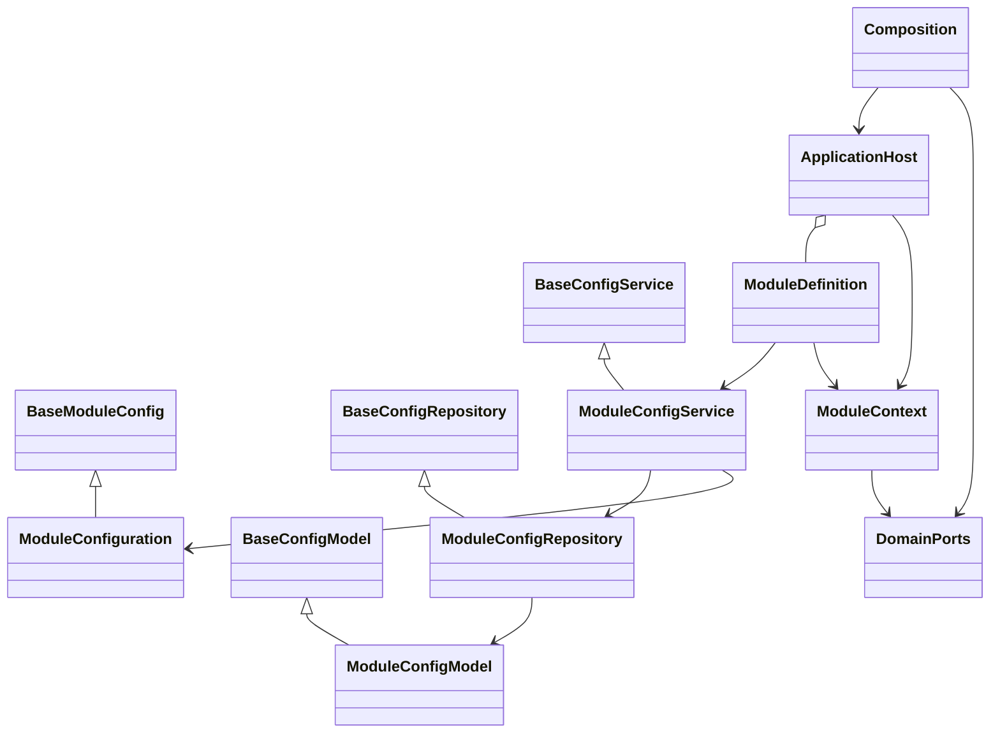
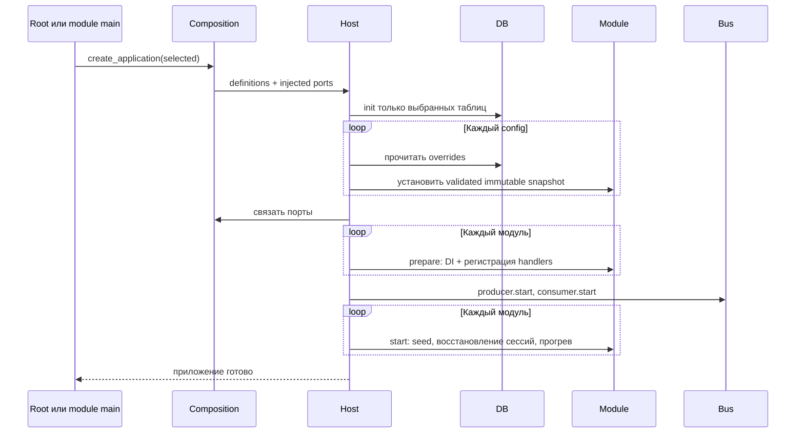

# ADR 0005: модульные точки запуска и общий жизненный цикл

Статус: принят; применяется ко всем 11 модулям.

## Контекст

Корневой main собирал роутеры, конкретные сервисы, обработчики и интеграции.
Для запуска Batching требовалось импортировать и конфигурировать посторонние
компоненты, включая bootstrap администратора. Расширение не должно увеличивать
центральный файл или создавать зависимости между реализациями модулей.

## Решение

Каждый `modules/<name>/main.py` предоставляет `get_module()` и `create_app()`.
`ModuleDefinition` — декларация возможностей, а не базовый класс бизнес-сервиса:
имя, router, собственные ORM-модели, сервис конфигурации, установка/очистка снимка
и callbacks `prepare`, `start`, `quiesce`, `stop`. Неиспользуемые callbacks имеют
общую пустую реализацию; не требуем пустых методов в каждом модуле.



`composition/modules.py` содержит явный реестр модулей и импортирует только
выбранные entrypoints. Нет сканирования каталогов и регистрации обработчиков при импорте. Корневой `src/main.py` вызывает сборку этого реестра. Список ORM-моделей
принадлежит модулю; `composition/models.py` использует тот же реестр для Alembic.
Общие слои `base/core/bus/domain/utils` не импортируют модули или composition.

Модуль не импортирует реализацию другого модуля. Общие структуры и Protocol-порты
находятся выше модулей; адаптеры связывает composition. Это правило покрывается
архитектурными тестами, включая относительные и ленивые импорты.

## Запуск



Хост владеет единственными DB/bus в процессе. `ModuleContext` передаёт producer,
consumer, safe-mode flag, снимки конфигурации и явно внедрённые порты/ресурсы.
Конкретные менеджеры клиентов создаются модулем без сетевого I/O; подключение
начинается только в `start`. Только Auth читает ADMIN_EMAIL/ADMIN_PASSWORD,
поэтому запуск Batching и других модулей не требует bootstrap учётной записи.
JWT_SECRET_KEY остаётся обязательным для проверки административных HTTP запросов.

Обычный main собирает модули в **одном процессе**. Отдельный запуск:

```sh
uvicorn src.main:app
uvicorn src.modules.batching.main:create_app --factory
uvicorn src.modules.memory.main:create_app --factory
```

Для нормального отдельного запуска нужен `MESSAGE_BUS=kafka`; группа потребителя
получает суффикс имени модуля. Процессы используют общую PostgreSQL и Kafka.
В safe mode любая фабрика запускает локальный API без Kafka/моделей/клиентов;
конфигурационные API доступны, бизнес-ручки внешних интеграций возвращают 503.
Production использует Alembic, а не CREATE_TABLES_ON_STARTUP.
Python main не запускает дочерние сервисы: это задача Compose/оркестратора.

## Остановка и ошибки

Сначала `quiesce` прекращает приём из внешних клиентов. Для Kafka останавливается
consumer; для in-memory очередь обрабатывается до завершения. Затем `stop`
сбрасывает pending Batching и ожидает фоновые операции Orchestrator;
in-memory очередь дренируется после каждого `stop`. Этот этап идёт в порядке
реестра: Batching сбрасывает пакеты до ожидания фоновых задач Orchestrator.
Далее закрываются consumer, producer,
привязки конфигурации и DB. Дренирование ограничено 30 секундами, весь этап
модульной остановки — 60 секундами. При ошибке exit stack всё равно закрывает
общие ресурсы; ошибка не скрывается. Несброшенное состояние не является durable.

Неверная конфигурация или недоступная БД останавливает startup. Нет fallback на
ENV. Handlers регистрируются до начала потребления. HTTP readiness появляется
только после успешного `start` всех выбранных модулей.

## Границы выделения сервисов

Точка запуска не означает, что все локальные зависимости стали сетевыми:

- Memory и Behavior получают AI-порты от composition. Текущий адаптер локальный,
  использует библиотеку LLM и её конфигурацию; отдельный HTTP/Kafka AI-протокол
  не добавлен. При таком запуске дополнительно читается таблица LLM config,
  но роутеры/обработчики LLM-сервиса не запускаются.
- STT использует `MediaDownloader`. В монолите порт предоставляет Telegram;
  отдельному рабочему STT нужен явно внедрённый адаптер. Фабрика принимает `ports`;
  без адаптера обычный запуск завершается понятной ошибкой. Safe API доступен.
- Batching хранит pending в памяти. Нужен один worker/экземпляр, пока не появятся
  partition affinity и durable state. Не запускать монолит и отдельный Batching
  одновременно для одной цепочки: разные группы получат те же события.
- Общая БД, локальные locks и отсутствие outbox сохраняют ограничения ADR 0001.
  Exactly-once, независимые базы и автоматическое масштабирование не обещаются.

## Роутеры и дальнейшее расширение

Конфигурационные роутеры лежат в `routers/manager/configuration.py`, рядом
с остальными manager сущностями, а не в `config/`. Префиксы собираются по уровням
согласно ADR 0002. Главный main не подключает отдельные entity/config routers.

Новый модуль добавляет собственные config/table, routes и main, затем запись
в реестре и миграцию. Общие фабрики конфигурации не копируются. Бизнес-сервисы
сохраняют простой `service.py` либо единый `services/` по числу обязанностей;
одновременно обе формы не используются.
